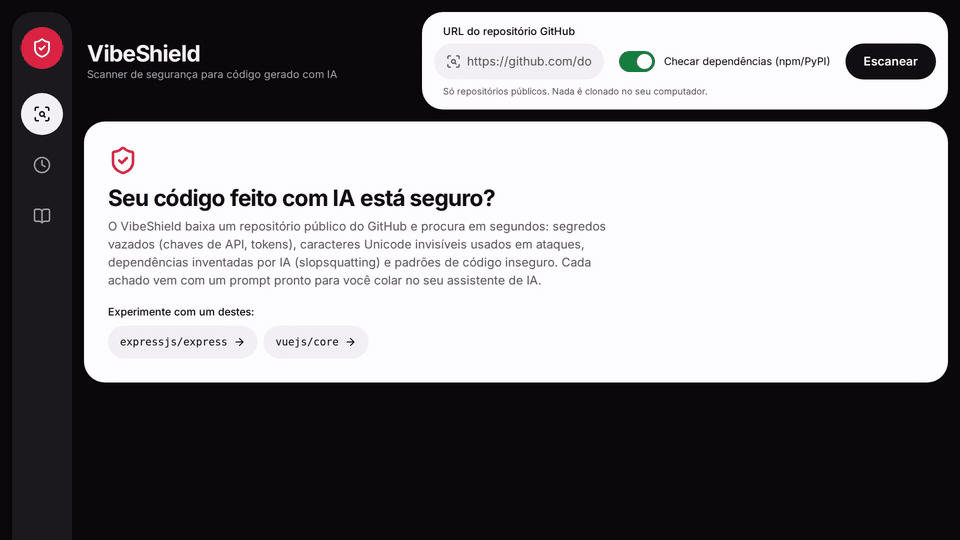
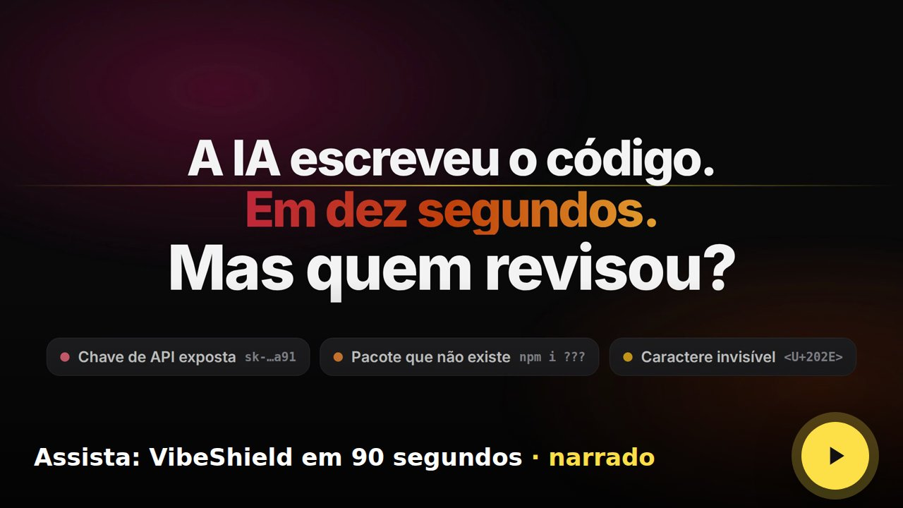

<div align="center">



<br>

**Cole a URL de um repositório do GitHub. Em segundos, descubra o que a IA deixou passar.**

Segredos vazados · Unicode invisível · pacotes inventados (slopsquatting) · código inseguro<br>
Cada achado com arquivo, linha e um **prompt de correção pronto** para colar no seu assistente de IA.

<br>


<br>


[**▶ Ver o vídeo**](#-veja-em-ação) · [**Como rodar**](#rodar) · [**API (Rust)**](https://github.com/Joao-Pedro-AI-Visionary/vibeshield-api) · [**Regras de detecção**](https://github.com/Joao-Pedro-AI-Visionary/vibeshield-api#regras-de-detecção)

</div>

---

## ✨ Por que usar

| | Benefício | Na prática |
|---|---|---|
| ⚡ | **Resposta em segundos** | O express (216 arquivos) é varrido em ~1,3 s; o vuejs/core (701 arquivos), em ~3,8 s. |
| 🎯 | **Feito para código de IA** | Procura exatamente o que os assistentes erram: chave colada, pacote alucinado, Unicode escondido. |
| 🤖 | **Correção em um clique** | Cada achado vem com um prompt pronto. Copie, cole no Claude, Copilot ou ChatGPT, e ele conserta. |
| 🔒 | **Seguro por padrão** | Nada é clonado no seu computador e nada do projeto é executado; segredos aparecem sempre mascarados. |
| 📊 | **Nota que todo mundo entende** | Nota de A a F e score de 0 a 100, com gráfico por severidade e por categoria. |
| ♿ | **Acessível e responsivo** | Contraste AA, foco visível, alvos de 44 px, navegação por teclado e layout para celular. |

## 🎬 Veja em ação

<div align="center">

<picture>
  <source media="(prefers-reduced-motion: reduce)" srcset="docs/screenshots/desktop-1440.png">
  
</picture>

<br><br>

<a href="docs/readme/vibeshield-demo.mp4">
  
</a>

<sub>Vídeo narrado de 1 min 30 s com legendas. Os achados mostrados vêm do repositório fictício de exemplo usado nos testes E2E.</sub>

</div>

## 🔍 O que ele encontra

| Categoria | Exemplo do que pega | Por que importa |
|---|---|---|
| 🔑 **Segredos** | chaves AWS, GitHub, OpenAI, Anthropic, Stripe, Slack, Google, chave privada PEM e tokens de alta entropia | Chave exposta em repositório público costuma ser explorada em minutos. |
| 👻 **Unicode oculto** | controles bidirecionais (Trojan Source), tags Unicode, caracteres de largura zero | Escondem lógica do revisor humano e instruções de *prompt injection* para a próxima IA. |
| 📦 **Slopsquatting** | pacote que não existe no npm/PyPI ou que foi criado há menos de 30 dias | IAs inventam nomes de pacote; um atacante registra o nome e entrega código malicioso. |
| 🧨 **Código inseguro** | `eval`, CORS liberado para qualquer origem, `innerHTML` com dado dinâmico | Padrões que a IA repete e que abrem XSS e execução arbitrária. |

## ⚙️ Como funciona

<div align="center">

</div>

O front valida a URL com a mesma regra da API, chama `POST /api/v1/scans` e mostra o relatório em um painel bento. O histórico dos 10 últimos scans fica só no seu navegador.

## 🧱 Tecnologias

| Camada | Stack |
|---|---|
| **Front (este repo)** | Vue 3.5 · TypeScript 5.9 · Vite 8 · Tailwind CSS 4 · Vitest + @vue/test-utils · Playwright |
| **API** ([vibeshield-api](https://github.com/Joao-Pedro-AI-Visionary/vibeshield-api)) | Rust 2024 · axum 0.8 · Tokio · rayon · reqwest (rustls) · utoipa (OpenAPI 3.1 + Swagger UI) |
| **Contrato** | [`docs/CONTRACT.md`](docs/CONTRACT.md), fonte única compartilhada pelos dois repositórios |

Todas as versões estão pinadas (sem `^`/`~`, `.npmrc` com `save-exact=true`).

---

## Rodar

```bash
cp .env.example .env        # ajuste VITE_API_BASE_URL se a API não estiver em localhost:8080
npm ci
npm run dev                 # http://localhost:5173 (a API precisa liberar essa origem em FRONTEND_URL)
```

## Scripts

| Script | O que faz |
|---|---|
| `npm run typecheck` | `vue-tsc --noEmit` |
| `npm run test` | testes unitários (Vitest, jsdom) |
| `npm run build` | build de produção em `dist/` |
| `npm run e2e` | Playwright (Chromium) contra o dev server, com a API mockada por `page.route` |
| `npm run screenshots` | regera `docs/screenshots/desktop-1440.png` e `mobile-375.png` |

Para o E2E na primeira vez: `npx playwright install chromium`.

## Contrato

`docs/CONTRACT.md` é a fonte única. Os tipos ficam em `src/api/types.ts` (escritos à mão a partir do contrato) e o
cliente em `src/api/client.ts`:

- valida a URL com a **mesma regex** do contrato antes de enviar (erro inline perto do campo);
- `POST {VITE_API_BASE_URL}/scans` com timeout de 90 s (`AbortController`);
- traduz cada `error.code` (`INVALID_REPO_URL`, `REPO_NOT_FOUND`, `REPO_TOO_LARGE`, `RATE_LIMITED`, `SCAN_TIMEOUT`…)
  para uma mensagem em pt-BR; falha de rede vira "API fora do ar".

## Estrutura

```
src/
  api/          types.ts (contrato) e client.ts (fetch, validação, erros)
  lib/          formatação, donut, histórico (localStorage), prompts, rótulos e regras
  composables/  useScan (estado idle/loading/error/success + histórico)
  components/   cards do bento (score, achados, donut, CTA, métricas, histórico, estados)
  views/        Metodologia
tests/unit/     Vitest
e2e/            Playwright + fixtures/scan.json (resposta de exemplo no formato do contrato)
docs/readme/    banner e fluxo (SVG animado), GIF de demonstração e vídeo narrado
```

## Navegação

Hash simples, sem vue-router: `#/scan`, `#/historico`, `#/metodologia`. O histórico guarda os 10 últimos resultados
**só neste navegador** (`localStorage`); se o storage estiver bloqueado ou cheio, a página continua funcionando.

## Acessibilidade

Tokens com contraste AA (`src/style.css`, `@theme`), foco visível de 2 px com offset, alvos de 44 px ou mais,
severidade sempre com ícone + texto, `aria-pressed` nos filtros, `aria-live` no "Copiado", e
`prefers-reduced-motion` desliga as animações (inclusive as do banner e do fluxo deste README).
Em telas de até 767 px o trilho vira barra inferior fixa.

## Créditos

- Inspiração visual: shot "Fintech Web App UI Design" de Ronas IT no Dribbble (https://dribbble.com/shots/26042215-Fintech-Web-App-UI-Design).
- Narração do vídeo: voz do autor clonada com [OmniVoice](https://github.com/k2-fsa/OmniVoice) (k2-fsa, Apache-2.0).

<div align="center">
<sub>Se o VibeShield te ajudou, deixe uma ⭐ para mais gente encontrar.</sub>
</div>
